### MemLabs Memory Forensics Challenge

**Aims & Objectives**

**Lab 1: Beginner's Luck**

lab description
My sister’s computer crashed. We were very fortunate to recover this memory dump. Your job is get all her important files from the system. From what we remember, we suddenly saw a black window pop up with some thing being executed. When the crash happened, she was trying to draw something. Thats all we remember from the time of crash.

I have a memory dump file that is from MemLabs. lets hava a look at the basic information of the memory dump file.
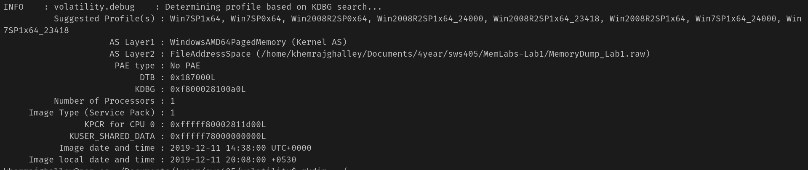
```
vol.py -f MemoryDump_Lab1.raw
```
we have to determine a profile of each memory dump and after got the suitable profile for this memory dump.
Now i have to see what was happening or what user was doing at the time of memory dump. I have to see what processes were running at the time of memory dump.

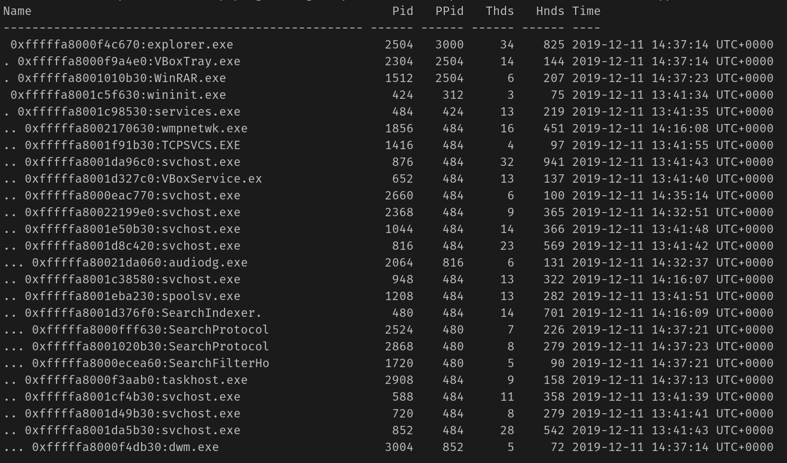

some of the files that are intresting to investigate on.

lets figure out more from it. 
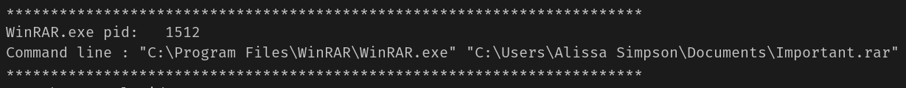
this process includes files that are intresting to investigate on. lets figure out more from it. first lets dump the file on disk and then we can analyze it.

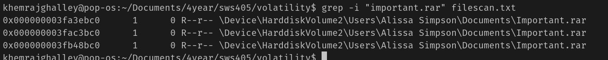
this is the file that extracted from the memory dump. lets see what is inside it.

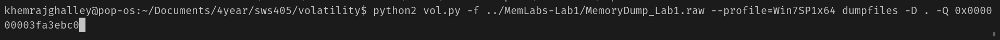

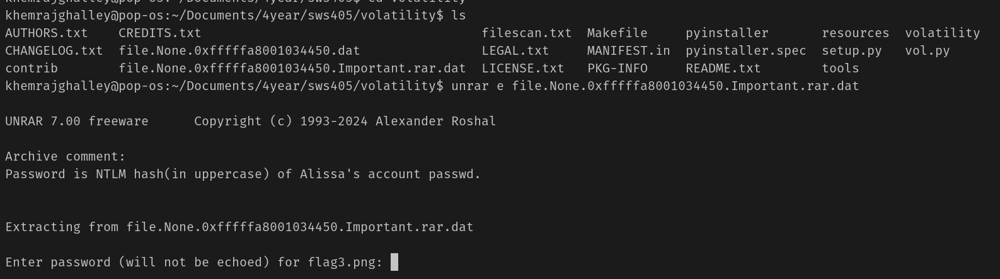
it says "Password is NTLM hash(in uppercase) of Alissa's account passwd."

lets dump all NTLM hash then we should use this hash to view an image file by now.

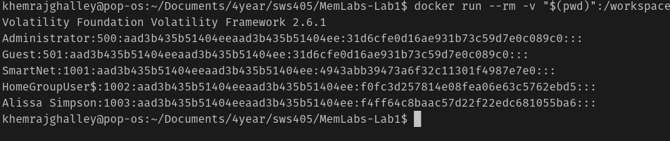
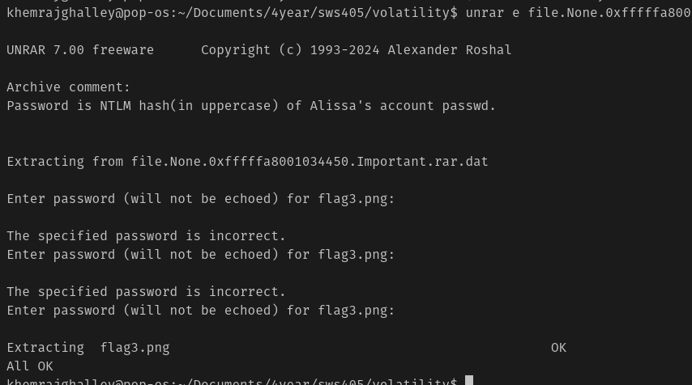

here is the flag for this lab.


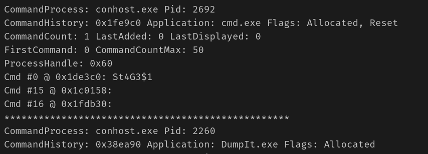
we can even use consoles plugin to see what was happening in these processes.
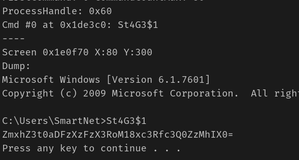

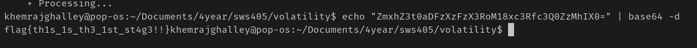
it says "this is the first stage"
now lets hunt for the second stage. we can use the same method to find the second stage. lets see what we can find in the memory dump.

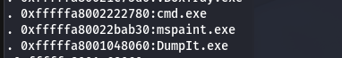
using the pstree command we can see these 2 processes were running at the time of memory dump. lets see what was happening in these processes. mspaint doesn't have any arguments, means that this file isn't saved lets dump the mspaint process and see what we can find in it.

**MemLabs Lab 2: A New World**

**Description**: One of the clients of our company, lost the access to his system due to an unknown error. He is supposedly a very popular "environmental" activist. As a part of the investigation, he told us that his go to applications are browsers, his password managers etc. We hope that you can dig into this memory dump and find his important stuff and give it back to us.

Lets find important files from the memory dump. we can use the same method to find the important files from the memory dump. lets see what we can find in the memory dump.

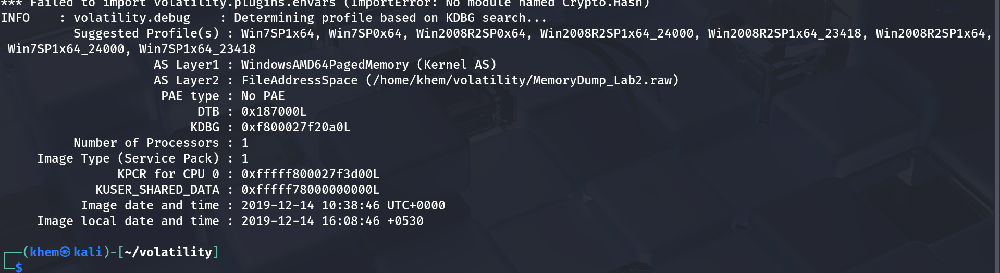
this is the imageinfo

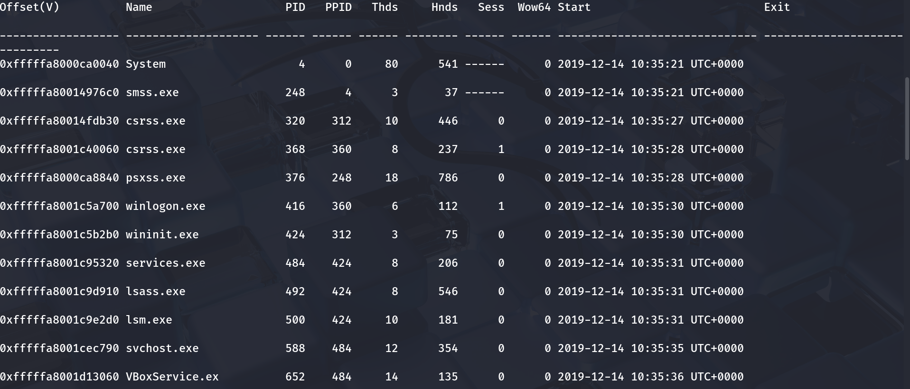
there are lots of processes running at the time of memory dump. lets see what we can find in these processes. let me look at most valuable processes 

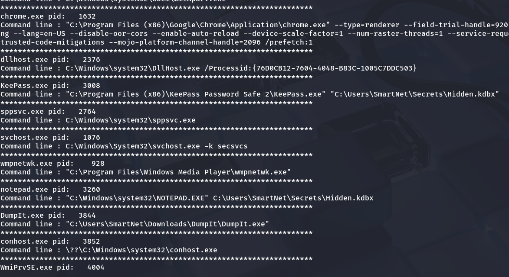
there must be hidden files in the Hidden.kdbx 

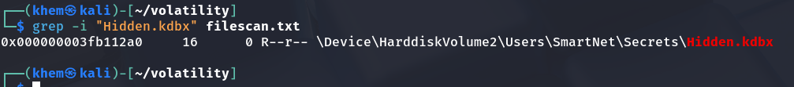
lets grab its offset to dump the file.

```
                                                                                                                                                                                              
┌──(khem㉿kali)-[~/volatility]
└─$ python2 vol.py -f MemoryDump_Lab2.raw --profile=Win7SP1x64 dumpfiles -D . -Q  0x000000003fb112a0 -n 
Volatility Foundation Volatility Framework 2.6.1
DataSectionObject 0x3fb112a0   None   \Device\HarddiskVolume2\Users\SmartNet\Secrets\Hidden.kdbx

```
now we have that file in our local machine.
the file is locked with password. we need password to unlock it. lets see if we can find the password in the memory dump.

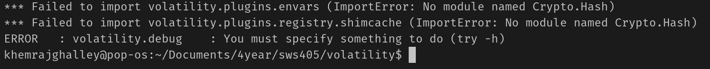

I am not able to use the envars plugin to find the password. finally after 2 hours of trying different methods, I could run the envars plugin to find the password.

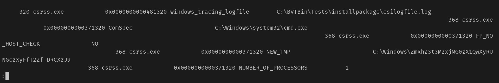
found the base64 encoded password. lets decode it maybe i wll get some useful stuff

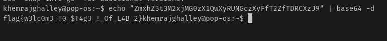
ohh! it is flag 1

here are the hashes 
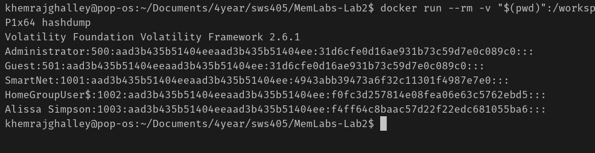
now we will find the file related to this users 
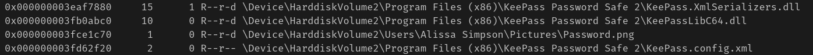
now lets dump the file and see what is inside it.
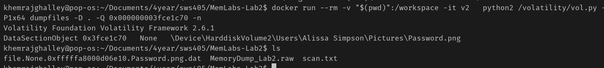

I got the file and i don't know how to open it.
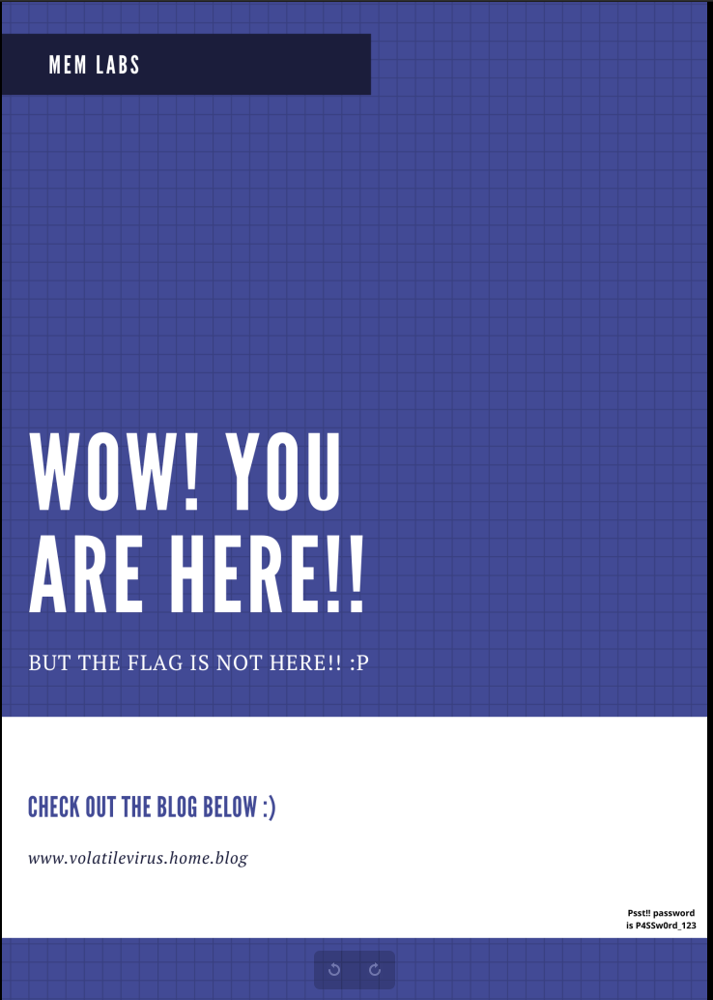

it says "Psst!! password is P4SSw0rd_123"

may be it could be the password for the database file. lets try to open the database file with this password.

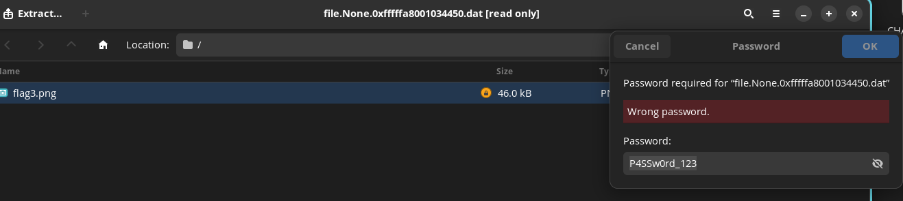
the password didn't work for me 

Lets move to hunt for the next flag. in the challenge it says "go to browser application"

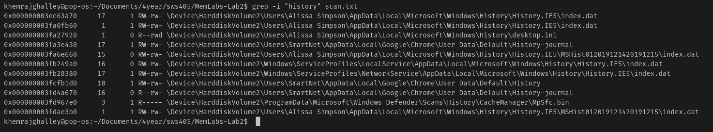
browser history will be stored in the History file. lets dump the history file and see what we can find in it.

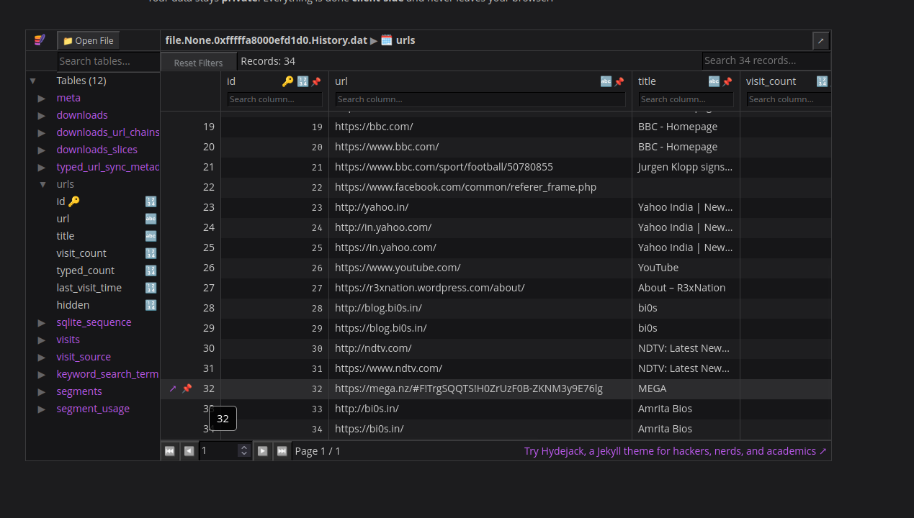

i dump the history file and go through the url and found the ineteresting url 
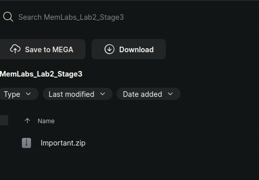
when i visit the url there is zip file and it is stage 3 of lab 2

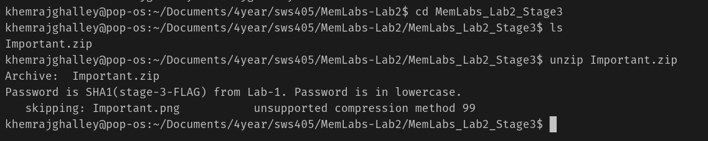
info: "Password is SHA1(stage-3-FLAG) from Lab-1. Password is in lowercase."
```
flag{w3ll_3rd_stage_was_easy}
```
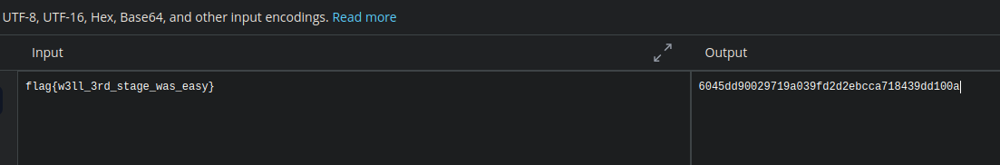
i converted the password to SHA1 and got the password for the zip file. i extracted the zip file and got the flag 3 of lab 2
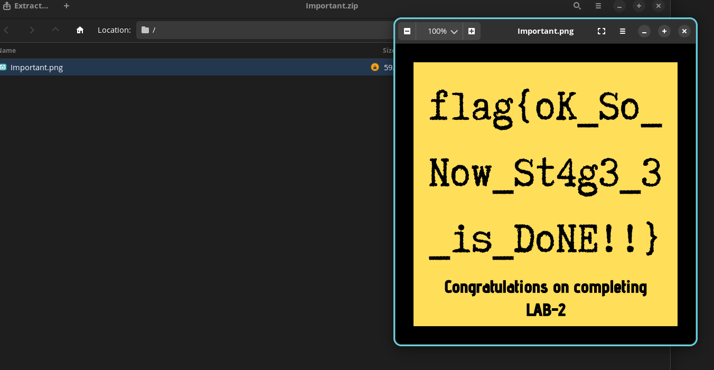
this is the last state of lab 2

I couldn't get the one of the flag because I was not able to open the database file tough I got the password for it. 

**Lab 3: The Final Stage: The Evil's Den**

**Challenge Description**:
A malicious script encrypted a very secret piece of information I had on my system. Can you recover the information for me please?

Note-1: This challenge is composed of only 1 flag. The flag split into 2 parts.

Note-2: You'll need the first half of the flag to get the second.

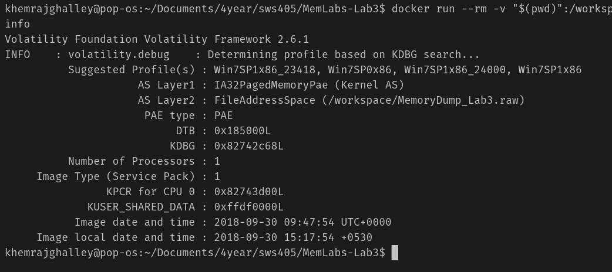
basic info about the .raw file

listing the processes
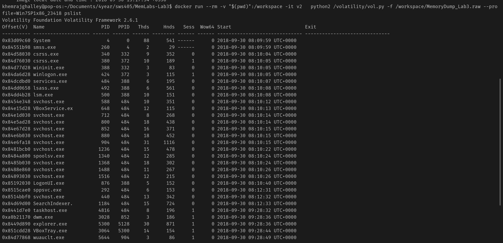

i have to find the script that encrypted the file. lets find the it 
we can use the cmdline plugin to find the script that encrypted the file.
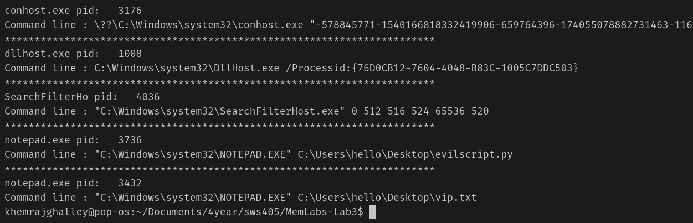
and here is it the evilscript.py and vip.txt this doesn't look like a normal file.

lets use filescan plugin to find the suspicous files and we can get its offset

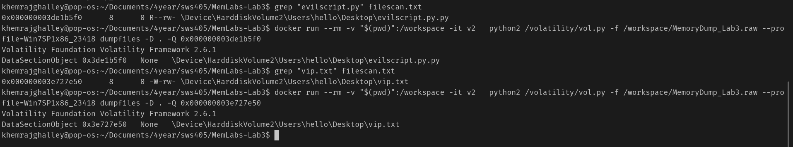
i have dumped both the files evilscript.py and vip.txt

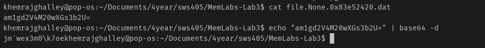

in the vip.txt there is base64 characters and when it decode it, it gave wired output "jm`wex3m0\k7oe"

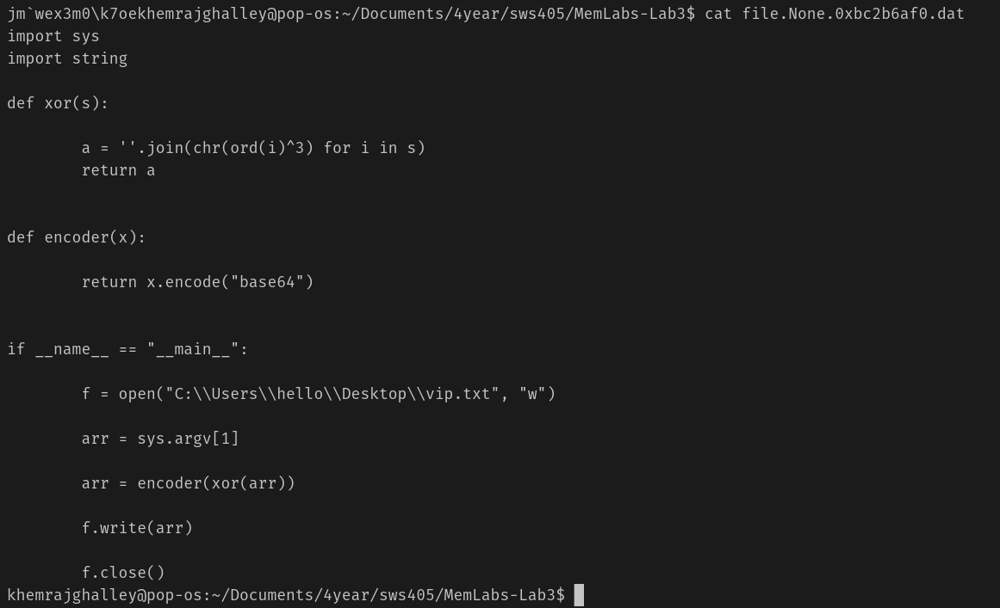

the script is reading vip.txt and xor it with key given by the user and use encoder function to encode ciphertext from the xor base64 then write that output to vip.txt replacing the old content 

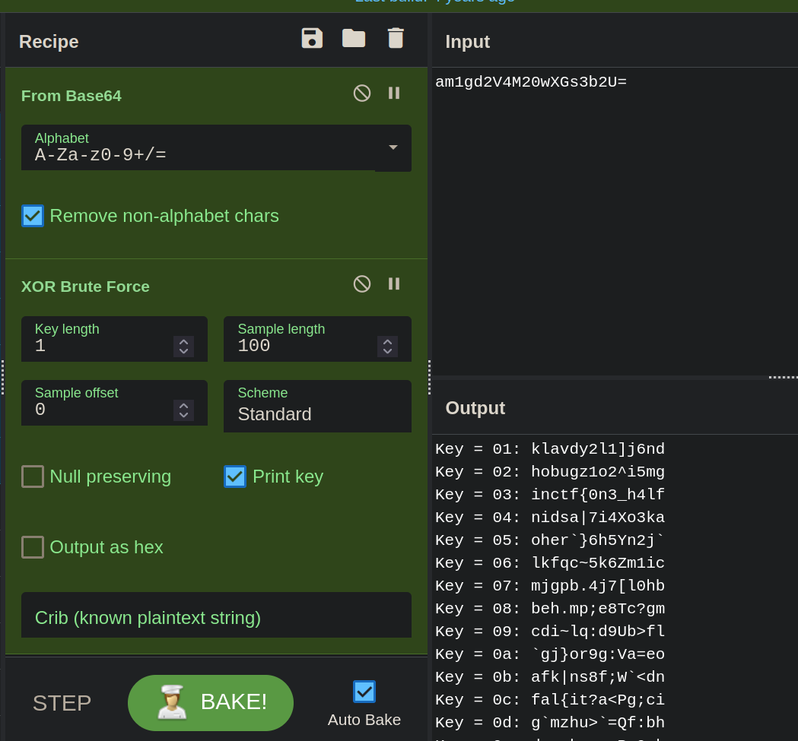

got the first half of the flag "inctf{0n3_h4lf"
To move to the next step we need the steghide, so the steghide are mostly used for the image. so lets find image in the filescan list

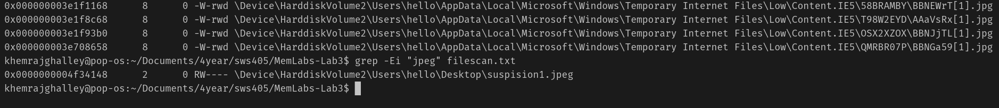
first i searched for the jpg and there was nothing suspicous but when i searched for the jpeg there was one file "suspision1.jpeg"

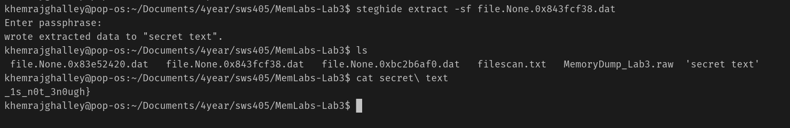
finally after trying multiple tools because i missed the hint given in the challenge description, i was able to extract the second half of the flag from the image file. passphrass to extract was the first half of the flag.

flag: "inctf{0n3_h4lf_1s_n0t_3n0ugh}

**Lab 4: Obsession**

Challenge Description:

My system was recently compromised. The Hacker stole a lot of information but he also deleted a very important file of mine. I have no idea on how to recover it. The only evidence we have, at this point of time is this memory dump. Please help me.

Note: This challenge is composed of only 1 flag.

The flag format for this lab is: inctf{s0me_l33t_Str1ng}

basic info about the .raw file 
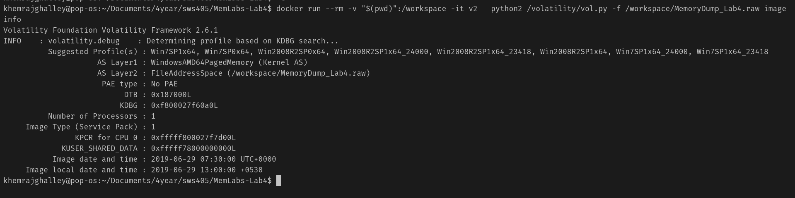


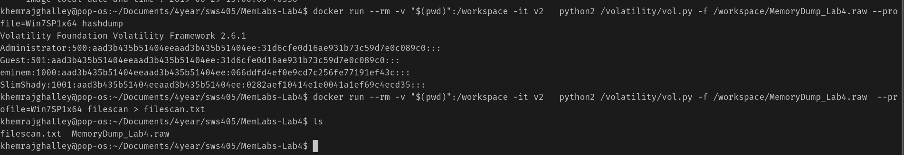
Here i used hashdump to know the users on the system and the filescan to know the files addresses with all the files from this memory dump

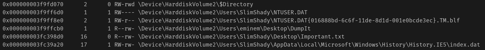
after scaning the files I found the file named "Important.txt" and the offset of the file is 0x000000003fc398d0. lets dump the file and see what is inside it.

no file is getting dumped from the memory dump, means that the file is been deleted for real 

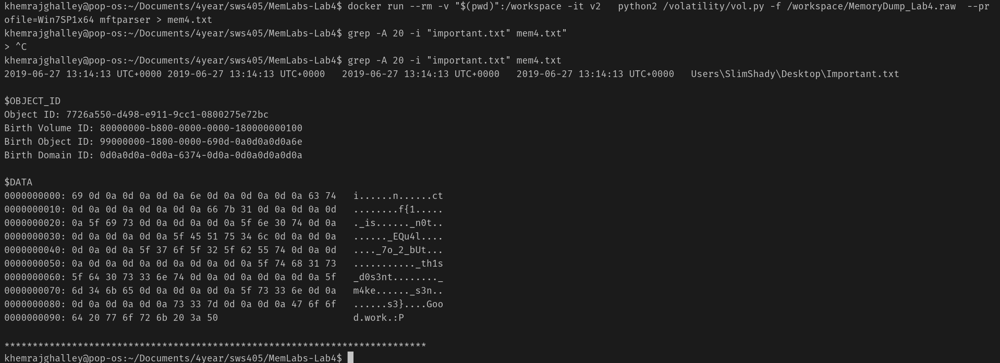
using mftparser plugin, we can extract the Master File Table (MFT) from the memory dump and save it to a text file called mem4_mft.txt. This is done to avoid overwhelming our terminal with a large amount of text. After the extraction is complete, we can use the grep command to search for "important.txt" in the mem4.txt file and display 20 lines following the matching line. This will allow us to locate the flag, which is embedded in the hex data, and we can then remove any white spaces to retrieve the flag.

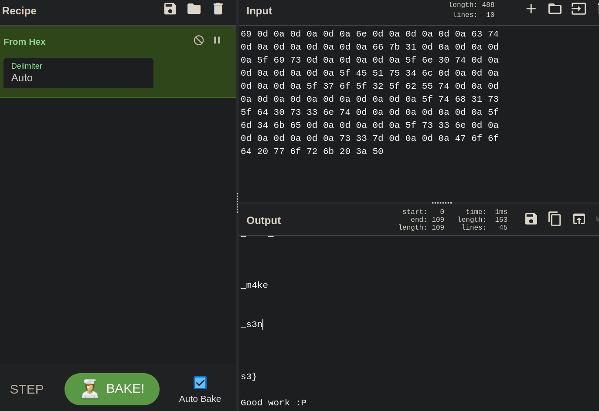
inctf{1_is_n0t_EQu4l_7o_2_bUt_th1s_d0s3nt_m4ke_s3ns3} Good work :P

got the flag for this lab.

**Lab 5: Black Tuesday**

We received this memory dump from our client recently. Someone accessed his system when he was not there and he found some rather strange files being accessed. Find those files and they might be useful. I quote his exact statement,

    The names were not readable. They were composed of alphabets and numbers but I wasn't able to make out what exactly it was.

Also, he noticed his most loved application that he always used crashed every time he ran it. Was it a virus?

Note-1: This challenge is composed of 3 flags. If you think 2nd flag is the end, it isn't!! :P

Note-2: There was a small mistake when making this challenge. If you find any string which has the string "L4B_3_D0n3!!" in it, please change it to "L4B_5_D0n3!!" and then proceed.

Note-3: You'll get the stage 2 flag only when you have the stage 1 flag.

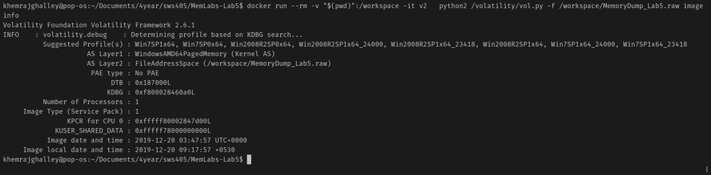
information on the memory dump file

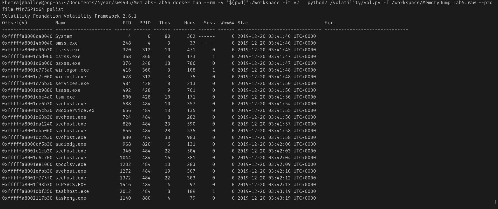

firstly, I checked the command line to locate the files since the NOTEPAD process was running. However, instead of a file name, we found the name of a RAR file. Additionally, it was interesting to note that NOTEPAD was running from the Videos folder.
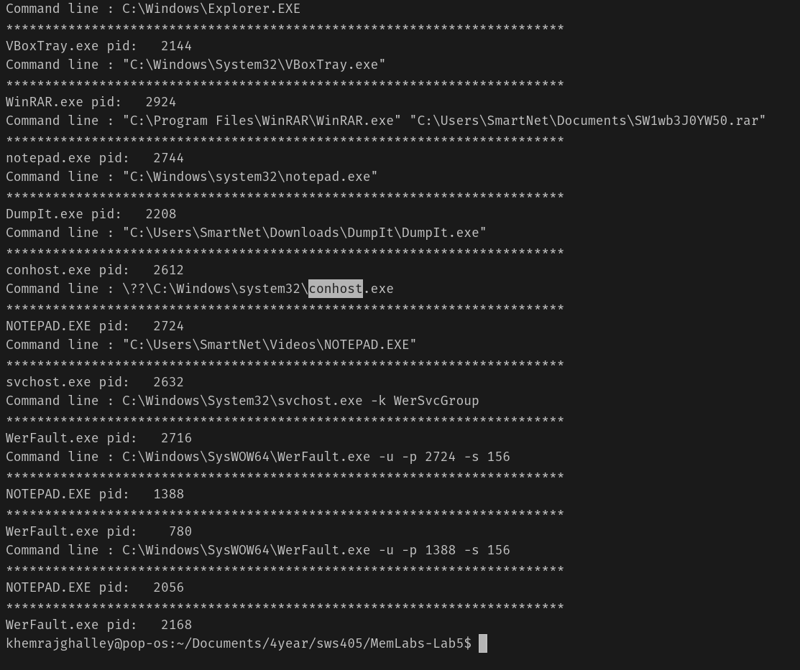

I dumped the rar file, but as we know, it is password protected. Additionally, the challenge description indicates that we cannot obtain the stage 2 flag before acquiring the stage 1 flag. Therefore, our first task is to locate the stage 1 flag.
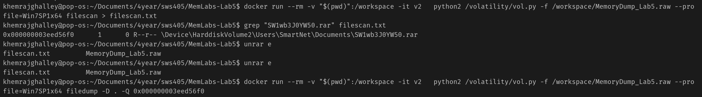


when I tried to open the file, it was for stage 2, so we need to find the stage 1 flag to find the stage 2 flag.

I dumped the NOTEPAD process that was running from the Videos folder, which resulted in three files being dumped. I examined all three files, but unfortunately, I couldn't find any useful information regarding the password for the RAR file or the first flag. 

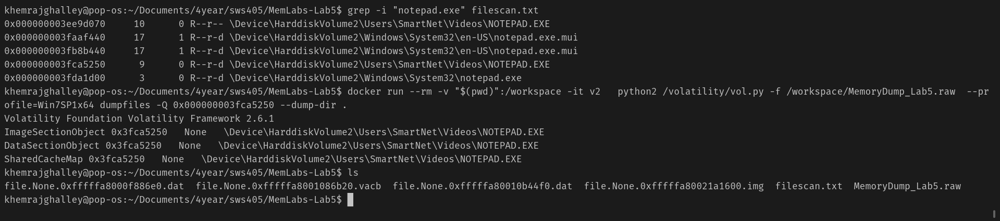

I started checking other plugins like cmdscan and clipboard, and during the netscan, I found a different executable that I have only seen in this challenge, namely wininit.exe.

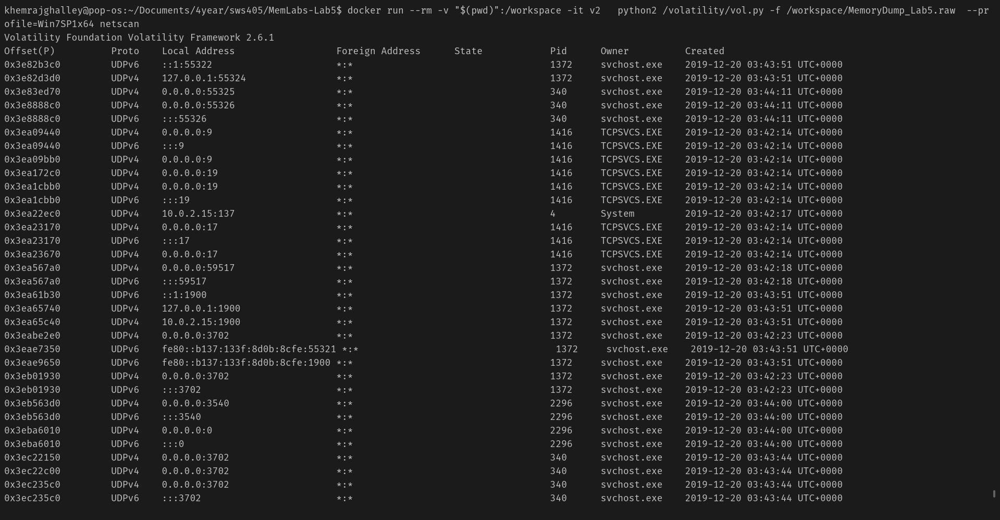

**iehistory**: This plugin is designed to recover fragments of Internet Explorer history index.dat cache files. It can identify basic accessed links (via FTP or HTTP), redirected links (— REDR), and deleted entries (— LEAK). The plugin applies to any process that loads and utilizes the wininet.dll library, not just Internet Explorer. This typically includes Windows Explorer and even malware samples. By using the iehistory plugin, we can find a list of files accessed by the browser, which may include numerous files to confuse us, as well as many old challenge files.

after searching for few minutes, this text seems to be useful.

when I decoded the base64 string, I got the first flag for this lab.

flag: flag{!!_w3LL_d0n3_St4g3-1_0f_L4B_5_D0n3_!!}

now lets move to the next stage. I am stuck because i don't have passphrase for the second flag maybe i can use first flag as passphrase for the second flag. lets see if it works.


i was right about the passphrase for the second flag. i used the first flag as passphrase and got the second flag.

**Plugin Used**

**imageinfo**:  It provides basic information about the memory dump, including the operating system version, service pack level, and architecture. It helps in determining the appropriate profile to use for analysis.

**cmdline**: This plugin retrieves the command line arguments of running processes at the time of the memory dump. It can help identify suspicious or interesting processes and their associated files.

**dumpfiles**: It allows us to dump files from the memory dump based on their offsets. It is useful for extracting specific files for further analysis.

**pslist**: lists all the running processes at the time of the memory dump. It provides information such as process IDs, parent-child relationships, and process names.

**cmdscan**: scans the memory dump for command line arguments of processes. It can help identify processes that were executed and their associated files.

**consoles**: retrieves the console output of running processes. It can provide insights into what was happening in the processes at the time of the memory dump.

**envars**: retrieves the environment variables of running processes. It can help identify sensitive information, such as passwords or configuration settings, that may be stored in environment variables.

**iehistory**: recovers fragments of Internet Explorer history index.dat cache files. It can identify accessed links, redirected links, and deleted entries, providing insights into the user's browsing activity.

**hashdump**: extracts the password hashes of user accounts from the memory dump. It can be useful for password cracking or further analysis of user credentials and it also list the users on the system.

**mftparser**: extracts the Master File Table (MFT) from the memory dump. It allows us to analyze the file system structure and locate specific files, even if they have been deleted.

**netscan**: scans the memory dump for network connections and provides information about active network sockets, including IP addresses, ports, and connection states. It can help identify suspicious network activity.


**filescan**: This plugin scans for all the files in the memory dump and provides their offsets, which can be used to dump specific files.

**Conclusion**

In this series of memory analysis labs, I have explored various techniques for extracting valuable information from memory dumps. Each lab presented unique challenges, requiring us to adapt our approach and utilize different tools and plugins.

In Lab 1, it focused on basic memory analysis techniques, learning how to identify and extract relevant data from memory dumps. We gained hands-on experience with tools like Volatility and learned how to interpret the results.

Lab 2 introduced us to more advanced techniques, including the use of plugins to recover specific types of data. I learned how to leverage the power of plugins to streamline our analysis and improve our chances of finding critical information.

In Lab 3, I encountered more complex scenarios, requiring us to think creatively and apply our knowledge in new ways. I learned how to combine multiple tools and techniques to achieve our goals.

Lab 4 challenged us to dig deeper into the memory dumps, uncovering hidden artifacts and recovering deleted files. We gained valuable experience in forensic analysis and learned how to approach complex cases methodically.

Finally, in Lab 5, we put our skills to the test, tackling a real-world scenario that required us to apply everything we had learned throughout the previous labs. We successfully extracted multiple flags, demonstrating our proficiency in memory analysis and forensic investigation.

Overall, these labs have provided us with a solid foundation in memory analysis techniques and have prepared us for future challenges in the field of digital forensics.

