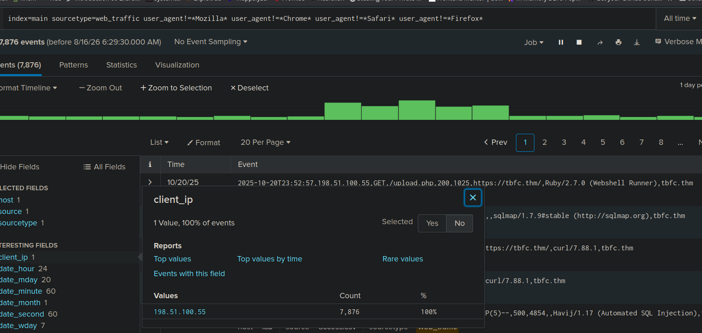
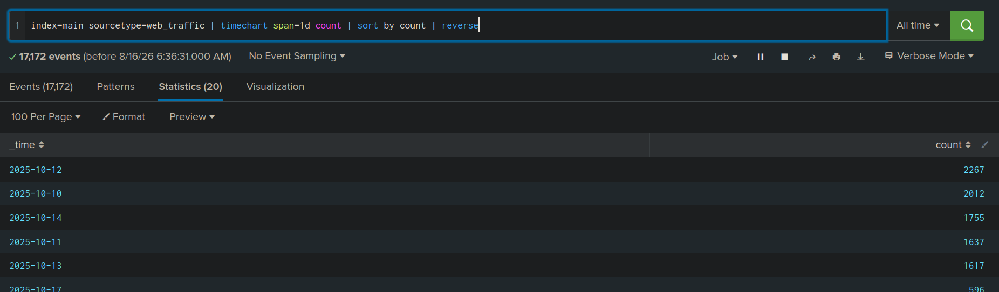
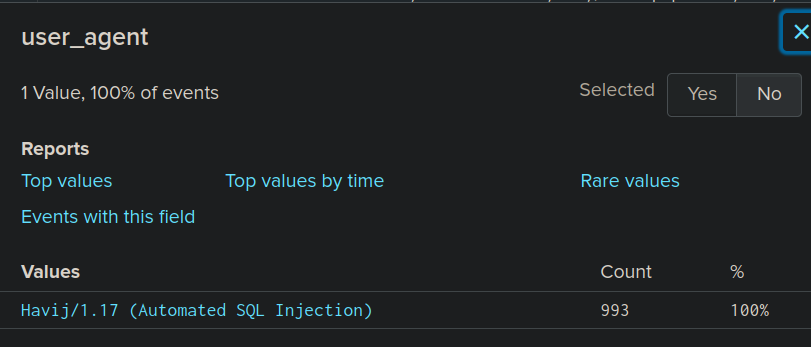
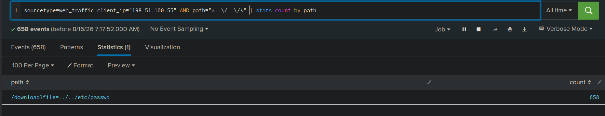
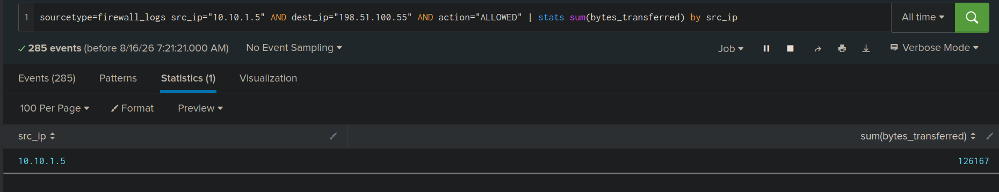
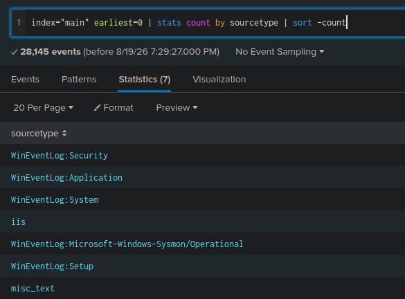

# Practical 01 Report

## Splunk Basics - Did you SIEM?


1. Aim
State in one or two sentences what this lab sets out to achieve.


2. Objectives
List the specific, measurable skills this lab is meant to build. Rewrite these in your own words based on what each room actually asked you to do — don't just copy this list.

---

3.1 What is Splunk / a SIEM, and why does it matter here?
- It is a tool to collect, analyze, and visualize data from different sources, which makes easy for security team to detect and respond to threats. 

**Scenario**

- The TBFC was busy preparing for Christmas, suddenly, the security team received a message from King Malhare demanding ransom of 1000 HopSec coin.  

3.3 What is Conti ransomware, in brief?
- Conti ransomware is a type of malicious software that encrypts files on a victim's system and demands a ransom payment for the decryption key.

4. Tools & Environment
Tool used: Splunk
Access method (AttackBox / OpenVPN): AttackBox
Splunk URL / instance: http://splunk:8000

### Lab 1: Splunk Basics (“Did you SIEM?”)

**Question**
1. What is the attacker IP found attacking and compromising the web server?
- The attacker IP found attacking and compromising the web server is 198.51.100.55.


```
index=main sourcetype=web_traffic user_agent!=*Mozilla* user_agent!=*Chrome* user_agent!=*Safari* user_agent!=*Firefox*
```
This command filters out the common user agents to focus on malicious traffic, allowing us to identify the attacker's IP address.

2. Which day was the peak traffic in the logs? (Format: YYYY-MM-DD)
- 2025-10-12 was the peak traffic day in the logs.
``` index=main sourcetype=web_traffic | timechart span=1d count | sort by count | reverse
```
This command creates a timechart of the web traffic logs, allowing us to identify the day with the highest number of requests.



3. What is the count of Havij user_agent events found in the logs?

- The count of Havij user_agent events found in the logs is 993

```
sourcetype=web_traffic user_agent!=*Mozilla* user_agent!=*Chrome* user_agent!=*Safari* user_agent!=*Firefox* user_agent=*Havij* | stats count by client_ip | sort -count | head 5
```

We can simply filter the logs for the Havij user agent and count the number of events associated with it.



4. How many path traversal attempts to access sensitive files on the server were observed?
- There were 658 path traversal attempts to access sensitive files on the server.

```sourcetype=web_traffic client_ip="198.51.100.55" AND path="*..\/..\/*" OR path="*redirect*" | stats count by path
```
To find the number of path traversal attempts, we can filter the logs for requests that contain "*..\/..\/*" in the path and count the number of events. As we already know the attacker IP, we can also filter by that to narrow down the results.



5. Examine the firewall logs. How many bytes were transferred to the C2 server IP from the compromised web server?
- There were 126,167 bytes transferred to the C2 server IP from the compromised web server.
```sourcetype=firewall_logs src_ip="10.10.1.5" AND dest_ip="198.51.100.55" AND action="ALLOWED" | stats sum(bytes_transferred) by src_ip
```
To find the number of bytes transferred to the C2 server IP, we can filter the firewall logs for traffic from the compromised web server IP to the C2 server IP and sum the bytes transferred.



### Lab 2: Conti Ransomware Investigation

```index="main" earliest=0 | stats count by sourcetype | sort -count
``` 

I can see 28,145 events. For the first step, I will check the sourcetypes to see what kind of logs are available. There are 7 available event SourceTypes.




**Questions and Answers**

1. Can you identify the location of the ransomware? (Hint: Look for a common Windows binary located in an unusual location.)
- To find the location of the ransomware, I have to find for the event(ransomare executed) in the logs. By searching SourceType Sysmon I identified what event codes were available under the field “EventCode”:
```index=main sourcetype="WinEventLog:Microsoft-Windows-Sysmon/Operational"
```
The directory could be normal as the hint says it.

2. What is the Sysmon event ID for the related file creation event?


3. Can you find the MD5 hash of the ransomware?


4. What file was saved to multiple folder locations?


5. What was the command the attacker used to add a new user to the compromised system?

6. The attacker migrated the process for better persistence. What is the migrated process image (executable), and what is the original process image (executable) when the attacker got on the system?

7. The attacker also retrieved the system hashes. What is the process image used for getting the system hashes?


8. What is the web shell the exploit deployed to the system?


9. What is the command line that executed this web shell?


10. What three CVEs did this exploit leverage? Provide the answer in ascending order.


7. **Questions**

1. What is the difference between an index, a sourcetype, and a field in Splunk?
- An index is like a database where splunk srotes data, a sourcetype is a classification of the data that describes the source of the data, and a field is a piece of information extracted from the data.

2. What does the pipe ( | ) operator do in SPL, and why is it central to how Splunk searches work?
- The pipe operator ( | ) is used to add the next command to the search, allowing us to filter and analyze the data. It is central to how splunk searches work because it allows us to combine multiple commands to create refined/filtered searches.

3. What is the purpose of the “Interesting Fields” panel, and how did it help you during this investigation?
- The "Interesting Fields" panel in splunk displays the fields that are most used in the current search results. It helps during the investigation by allowing us to quickly refer to the fields.

4. Why is choosing the correct time range important in Splunk, and what could go wrong if it's set incorrectly?
- Choosing the correct time range is important in splunk because it allows us to focus on the common time frame of the events we are investigating. If it is set incorrectly, there is high possibility of missing important events, which could lead to incomplete or incorrect analysis.


5. How would you make a search you wrote today reusable as an alert that fires automatically in the future?
- I would save the search as a report and then create an alert based on that report. This way, the alert can be configured to trigger automatically based on specific conditions.

6. Why did the analyst pivot from Sysmon logs to IIS logs (and back) during the investigation? What does each log source tell you that the other doesn't?
- 


7. Why do attackers use process migration/injection (e.g. into a legitimate process) instead of just
running their tools directly?


Conclusion