# Practical Report: Recovering Deleted Files with The Sleuth Kit (TSK) on Kali Linux

## 1. Aim

To create a small NTFS disk image, put different types of files on it, delete them, and then find and recover all the deleted files using The Sleuth Kit (TSK) on Kali Linux. Each recovered file is checked with a SHA-256 hash to prove it is exactly the same as the original.

## Objectives

2. Understand how TSK looks at a disk in layers: image → partition → file system → file name → metadata → content.
3. Use the TSK tools `img_stat`, `mmls`, `fsstat`, `fls`, `istat`, `icat`, `ffind` and `tsk_recover`.
4. Find the partition offset and use it with `-o`.
5. Recover deleted files and check them with SHA-256 hashes.
6. Make a simple timeline of file activity using `fls -m` and `mactime`.


## Tools Used

| Tool | What it does |
|---|---|
| `img_stat` | Shows basic details about the image (type, size, sector size) |
| `mmls` | Shows the partition table and where each partition starts |
| `fsstat` | Shows details about the file system (type, label, cluster size, MFT) |
| `fls` | Lists file names, including deleted ones |
| `istat` | Shows full metadata of one file (times, size, location) |
| `icat` | Reads and outputs the content of a file using its MFT number |
| `ffind` | Finds the file name from an MFT number |
| `blkcat` | Shows the raw content of one cluster |
| `tsk_recover` | Recovers many files at once |
| `mactime` | Turns timestamp data into a timeline |
| `sha256sum` | Makes and checks SHA-256 hashes |

---


### Installing The Sleuth Kit

**Install the tools**

```bash
sudo apt update
sudo apt install -y sleuthkit ntfs-3g parted file python3
```

### Building the Evidence Image

**Make a blank 200 MB image**

```bash
dd if=/dev/zero of=evidence.dd bs=1M count=200 status=progress
```

This made a file of 209,715,200 bytes filled with zeros.

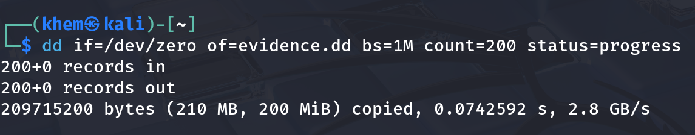

**Create a partition table and one partition**

```bash
parted -s evidence.dd mklabel msdos mkpart primary ntfs 1MiB 100%
parted -s evidence.dd unit s print
```

One partition was created starting at **sector 2048** (1 MiB ÷ 512 bytes = 2048).

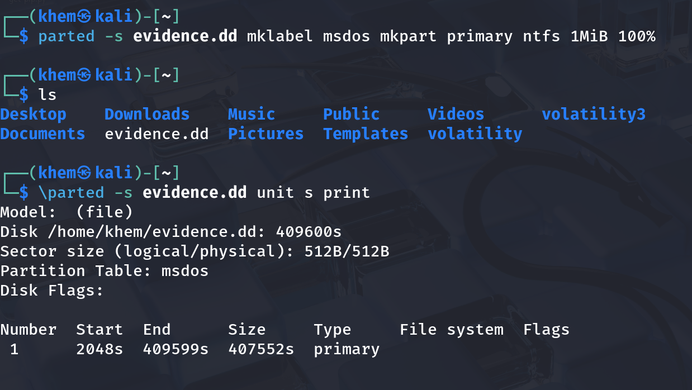


**Attach the image as a loop device**

```bash
LOOP=$(sudo losetup -fP --show evidence.dd)
echo $LOOP
ls ${LOOP}*
```

Linux now treats the image file like a real disk (for example `/dev/loop0` and `/dev/loop0p1`).

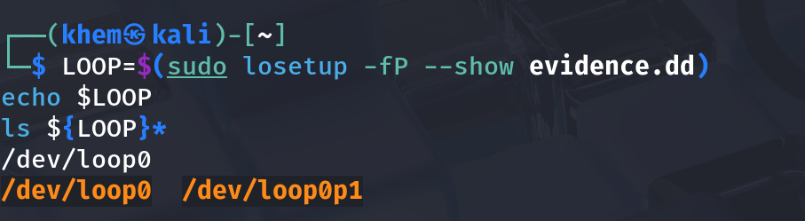

**Format the partition as NTFS**

```bash
sudo mkfs.ntfs -Q -L EVIDENCE ${LOOP}p1
```

The partition was quickly formatted as NTFS with the label **EVIDENCE**.

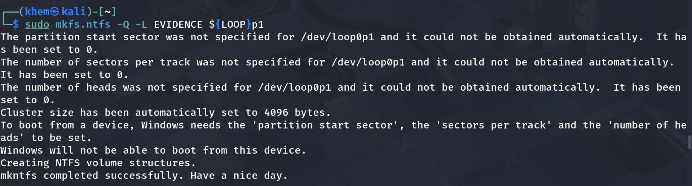

### Planting Test Files and Hashing Them

**Step Create the file generator script**
created the given python file.

**Run the script on the mounted drive**

```bash
sudo python3 ~/tsk_lab/make_files.py /mnt/evidence
ls -laR /mnt/evidence
```
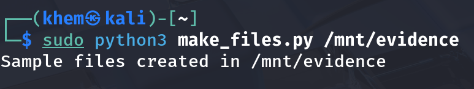

**Check file types by content**

```bash
cd /mnt/evidence && file $(find . -type f | sort)
```

The `file` command checks the first bytes of each file (its "magic number"), not just the name. All 9 files showed the correct type.

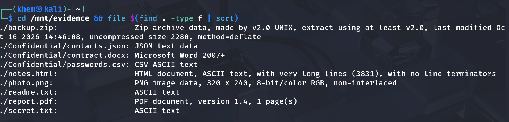

**Save the original hashes**

```bash
cd /mnt/evidence
sudo find . -type f ! -name readme.txt -exec sha256sum {} \; | sort -k2 > ~/tsk_lab/original_hashes.txt
cat original_hashes.txt
```

8 hashes were saved. These are used later to prove the recovery is correct.

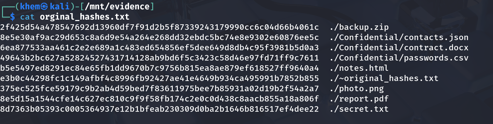


### Deleting the Files and Sealing the Image

**Delete the files**

```bash
cd /mnt/evidence
sudo rm -f secret.txt report.pdf photo.png notes.html backup.zip
sudo rm -rf Confidential
sync
ls -la /mnt/evidence
```

Only `readme.txt` was left on the drive.

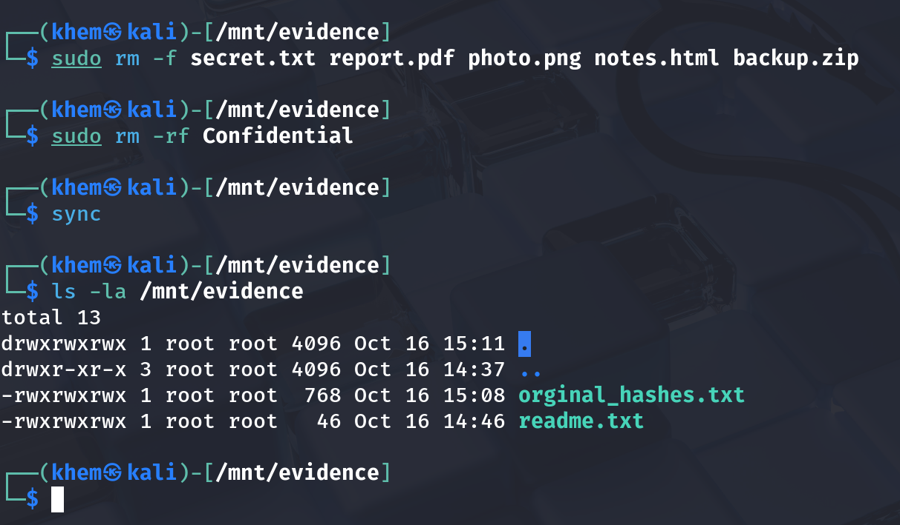


**Unmount and detach**

```bash
cd ~/tsk_lab
sudo umount /mnt/evidence
sudo losetup -d $LOOP
losetup -a
```

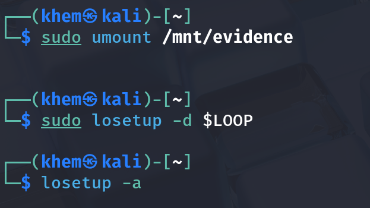

**Hash the image (acquisition hash) & Make the image read-only**

```bash
sha256sum evidence.dd | tee evidence.dd.sha256
chmod 444 evidence.dd
ls -l evidence.dd
```

The permissions became `-r--r--r--`, so the image cannot be changed by mistake.

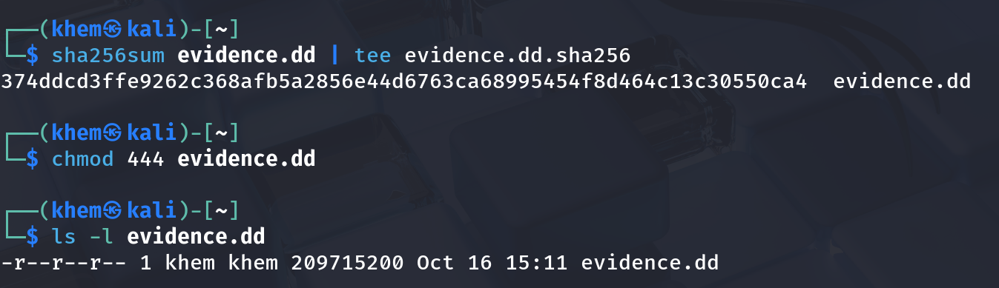

# practical 4

### Investigate the image with TSK

**Verify the evidence before touching it**

```jsx
cd ~/tsk_lab
sha256sum -c evidence.dd.sha256
```

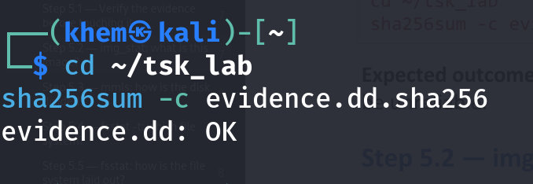

**img_stat: what is this image?**

```jsx
img_stat evidence.dd
```


**mmls: how is the disk divided?**

```jsx
mmls evidence.dd
```


**fsstat -t: which file system?**

```jsx
fsstat -t -o 2048 evidence.dd
```

**fsstat: how is the file system laid out?**

```jsx
fsstat -o 2048 evidence.dd | head -30
```


**fls: what files exist now?**

```jsx
fls -o 2048 evidence.dd
```


**fls -r -d -p: list every deleted file**

```jsx
fls -r -d -p -o 2048 evidence.dd
```


**istat: examine a deleted file’s metadata**

```jsx
istat -o 2048 evidence.dd 67
```


#### Recovering and Verifying the Files

**View the content of a deleted text file**

```bash
icat -r -o 2048 evidence.dd 65
```

The deleted note was fully readable on screen. The `-r` option turns on recovery mode for deleted entries.


**Step 6.2 – View the raw cluster (optional)**

```bash
blkcat -o 2048 evidence.dd 25984 | head -c 120
```

The cluster starts with `%PDF-1.4`, which proves the PDF data is still on the disk.


**Step 6.3 – Recover the PDF**

```bash
icat -r -o 2048 evidence.dd 67 > recovered/report.pdf
ls -l recovered/report.pdf
file recovered/report.pdf
```

The file is 4,030 bytes (same as `istat` showed) and is a valid PDF.


*Figure 29: Recovered PDF with correct size and type.*

*Figure 30: Recovered "CONFIDENTIAL REPORT – Project Falcon" opened.*

**Step 6.4 – Recover all other files**

```bash
cd ~/tsk_lab
icat -r -o 2048 evidence.dd 65 > recovered/secret.txt
icat -r -o 2048 evidence.dd 66 > recovered/passwords.csv
icat -r -o 2048 evidence.dd 68 > recovered/photo.png
icat -r -o 2048 evidence.dd 69 > recovered/contract.docx
icat -r -o 2048 evidence.dd 70 > recovered/notes.html
icat -r -o 2048 evidence.dd 71 > recovered/contacts.json
icat -r -o 2048 evidence.dd 72 > recovered/backup.zip
ls -l recovered
```

All file sizes matched the original listing from Step 3.2.


**Step 6.6 – Prove recovery with hashes**

```bash
    cd ~/tsk_lab/recovered
sha256sum -c <(sed 's#\./Confidential/#./#' ../original_hashes.txt)
cd ~/tsk_lab
sha256sum recovered/* | tee recovered_hashes.txt
```

### Bulk Recovery, Timeline and Final Check

**tsk_recover: recover all deleted files at once**

```bash
tsk_recover -o 2048 evidence.dd tsk_recovered
find tsk_recovered -type f | sort
cd tsk_recovered && sha256sum -c ../original_hashes.txt && cd ..
```

`Files Recovered: 8`, and the folder structure (including `Confidential/`) was rebuilt. All hashes were **OK**.


In this step I failed to prove the authenticity of the recovered file with the original hash

**Step 7.2 – Build a timeline**

```bash
fls -r -m / -o 2048 evidence.dd > bodyfile.txt
mactime -b bodyfile.txt -d -z UTC | grep -v '\$' > timeline.csv
cat timeline.csv
```

- All files were created at the same second.
- The `Confidential` folder shows a modify/change time a few seconds later. This is the moment its files were deleted.


**Step 7.3 – Final check of the evidence**

```bash
sha256sum -c evidence.dd.sha256
```

Result: `evidence.dd: OK`. The image did not change during the whole analysis.


## Answers to Review Questions

**1. Why does `fsstat evidence.dd` fail without `-o`, and where does 2048 come from?**
Sector 0 of the image is the partition table, not the file system. TSK needs to know where the partition starts. `mmls` showed the NTFS partition starts at sector 2048 (1 MiB ÷ 512 bytes), which is the value given in `parted`.

**2. What do `*` and `-/r` mean in `-/r * 67-128-2: report.pdf`?**`*` means the file is deleted. `-/r` shows the type from the directory entry and from the MFT entry: `-` means unknown (the deleted name entry no longer says), and `r` means it is a regular file.

**3. What is the difference between resident and non-resident, and how did `istat` show it?**
A resident file is small and stored inside its MFT entry. A non-resident file is stored in separate clusters. `istat` showed "Resident size: 72" for `secret.txt` and "Non-Resident size: 4030" with a cluster number for `report.pdf`.

**4. How did `icat` recover files without knowing their names?**`icat` uses the MFT entry number. The MFT entry tells it where the data is (inside the entry or in which clusters). The names were found earlier with `fls`, and I gave the names to the output files myself.

**5. Why compare SHA-256 hashes instead of just opening the files?**
A file can open fine but still have a few changed bytes. A hash checks every single byte, so a matching hash proves the file is exactly the same as the original. This is strong proof for a report or court.

**6. Two reasons a deleted file might not be recoverable on a real drive:**

- New files can be written over the freed clusters, so the data is overwritten.
- The MFT entry can be reused by a new file, so the name and data location are lost.
- (Also, SSDs with TRIM can erase freed blocks automatically.)

**7. What does the final `sha256sum -c evidence.dd.sha256` prove, and why is it important?**
It proves the image was not changed during the analysis, because its hash is the same as when it was taken. In court this shows the evidence is reliable and that the investigator did not change it.

## *Conclusion*

In this practical I built an NTFS disk image, added 8 different files, deleted them, and then recovered all of them using The Sleuth Kit. I used `mmls` to find the partition offset, `fsstat` to study the file system, `fls` to find deleted files, `istat` to read their metadata and `icat` / `tsk_recover` to recover them. All 8 recovered files matched the original SHA-256 hashes, and the image hash stayed the same before and after analysis. This shows that deleted files can be recovered as long as their data is not overwritten, and that TSK can do this without changing the evidence.